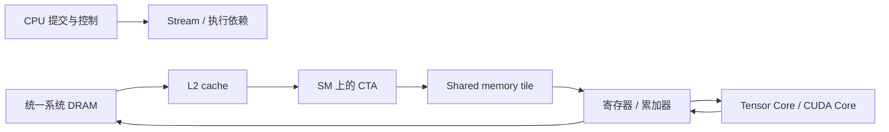

# GPU 内存层次、统一内存与 Roofline

GPU 推理的“放得下”和“跑得快”由不同资源约束。DGX Spark 的统一系统内存提供大容量，但权重、activation、CPU 与 GPU 的访问仍消耗真实带宽；很短的 kernel 还可能主要受 launch 与同步开销影响。

前置概念见 [存储系统](memory-system-overview.md)、[DMA](dma.md) 和 [精度编码](precision-encoding.md)。本文使用公开硬件规格与教学成本模型，不代表设备实测结果。

## GPU 执行与内存层次

一个 kernel 的线程组成 block / CTA，block 被调度到 SM。warp 是执行与调度的重要单位；Tensor Core 执行符合类型、布局与尺寸约束的矩阵运算。线程数量、SM 数量与 Tensor Core 吞吐之间不能直接画等号。

| 层次 | 典型作用域 | 主要限制 |
| --- | --- | --- |
| 寄存器 | 线程的私有值与累加器 | 过多会限制驻留 warp，或 spill 到 local memory |
| shared memory | block 内协作、tile 暂存 | 容量、bank conflict 与同步 |
| L1 / L2 cache | 缓存 global load/store | 命中、替换、工作集与跨 SM 竞争 |
| global memory | 权重、activation、workspace | DRAM 带宽、访问合并与真实传输字节 |
| 主机控制 | 提交、调度、状态消费 | CPU 时间、launch、设备完成等待 |

CUDA 的 `local memory` 是逻辑上的线程私有存储，通常由设备内存支撑；它不等于片上寄存器。寄存器 spill 可能增加原本未预期的 DRAM 流量。



这是逻辑路径，不表示每次访问都会逐级命中，也不表示 shared memory 必须参与每个 kernel。

## DGX Spark 的统一内存边界

[NVIDIA 硬件文档](https://docs.nvidia.com/dgx/dgx-spark/hardware.html) 给出 128 GB LPDDR5x 统一系统内存、273 GB/s 内存带宽，以及 20 核 Arm CPU。其公开的 FP4 稀疏峰值计算规格，不能替代 BF16 GEMM、softmax 或不满足稀疏条件的实际吞吐。

需要区分三组概念：

- **统一物理内存**：CPU 与 GPU 共享系统内存资源，容量仍需留给操作系统、运行时、workspace 与 cache。
- **统一虚拟地址（UVA）**：统一地址表示与指针分类，不保证任意主机指针在所有设备上都可直接高效访问。
- **CUDA Unified Memory**：托管分配、页驻留与访问管理机制；行为取决于硬件、驱动、分配方式及访问模式。

```cpp title="CUDA 能力查询：比较系统行为前先记录属性"
cudaDeviceProp p{};
cudaGetDeviceProperties(&p, 0);
printf("cc=%d.%d managed=%d concurrent=%d host_page_tables=%d\n",
       p.major, p.minor, p.managedMemory,
       p.concurrentManagedAccess, p.pageableMemoryAccessUsesHostPageTables);
```

字段含义见 [CUDA Runtime `cudaDeviceProp`](https://docs.nvidia.com/cuda/cuda-runtime-api/structcudaDeviceProp.html)。这段代码查询能力，未执行页迁移或带宽基准；错误处理在示例中省略，实际程序应检查返回值。

CPU 与 GPU 能访问同一份内存，不代表访问无需缓存一致性管理、同步或带宽。GPU kernel 完成前，CPU 不能仅凭“共享地址”就安全消费结果。CPU/GPU 交替写入同一工作集也可能损失局部性。

## Roofline 的两个下界

设一个算子需要 $F$ 次浮点运算，真实内存流量为 $D$ 字节，目标精度下的可用计算吞吐为 $P$，可用内存带宽为 $B$。理想时间下界为

$$
T_{\mathrm{compute}}\geq\frac{F}{P},\qquad
T_{\mathrm{memory}}\geq\frac{D}{B},\qquad
T_{\mathrm{ideal}}\geq\max\left(\frac{F}{P},\frac{D}{B}\right).
$$

算术强度与性能上界：

$$
I=\frac{F}{D},\qquad
P_{\mathrm{achievable}}\leq\min(P,BI).
$$

这里 $F/P$ 和 $D/B$ 是同时约束性能的下界，不应无条件相加。launch、依赖、同步和低 occupancy 会让实测高于该理想界。$D$ 应尽量来自 profiler 的真实流量；逻辑张量大小忽略了重复加载、cache 和 padding。

<iframe src="../assets/inference/roofline.html" title="GPU Roofline 与 launch 开销交互模型" loading="lazy" style="display:block;width:100%;height:560px;border:0;margin:1rem 0;border-radius:16px;"></iframe>

[单独打开 Roofline 模型](assets/inference/roofline.html)

交互图采用固定的教学吞吐，选择计算类型后只改变 launch 次数，观察它何时成为明显的额外成本。它不根据营销峰值预测 DGX Spark 的真实延迟。

## 从模型映射到实际算子

### GEMM 的复用

对 $A_{M\times K}B_{K\times N}$，乘加按 2 FLOPs 计，有 $F\approx2MKN$。理想各读一遍输入、写一遍输出时，若元素宽度为 $q$ 字节：

$$
D_{\mathrm{logical}}\approx q(MK+KN+MN).
$$

小 $M$ 的 MoE expert GEMM 在权重方向的复用较少；增加同一专家的 token 行数可以提高强度。具体 tile 与缓存行为见 [GEMM 分块与 CuTe](gpu-tiled-gemm-cute.md)。

### 大词表概率张量

单请求 $C=256$、$V=262144$，FP32 的 $[C,V]$ 概率张量为

$$
CV\times4=268435456\ \mathrm{bytes}=256\ \mathrm{MiB}.
$$

单独写出后再读一次已是 512 MiB 的逻辑流量，还不包括 logits、embedding 矩阵和其他消费者。融合可以避免其中的物化；若新增更多寄存器占用或重复读取，节约的流量不一定全部转成加速。

### launch 与同步

几个微秒量级的小算子可能由 launch 间隙主导；一个大 GEMM 可能已远大于 launch 成本。融合减少节点数，CUDA Graph 减少主机提交成本，设备侧循环减少逐轮同步，它们改变的部分不同。

应首先用时间线判断问题，再决定使用 [在线 softmax 融合](online-softmax-fusion.md) 或 [CUDA Graph](cuda-graphs-device-loop.md)。

## 代码阅读：分配与生命周期

```python title="教学示例：把 allocation 与稳态计算分开"
x = torch.empty((tokens, hidden), device="cuda", dtype=torch.bfloat16)
y = torch.empty_like(x)
# 构建、编译、预热都在计时窗口外完成
for _ in range(repeats):
    kernel(x, y)  # 同一形状与地址，kernel 应完整写入所需输出
```

预分配只排除分配开销，不保证地址上的内容自动正确。复用 workspace 还要检查有效范围、跨 stream 依赖和图重放前重置。`torch.empty` 的旧内容不能当作初始化状态。

同样地，量化后的权重字节减少，不代表全部算子同比加速：scale 读取、反量化、累加类型以及后端 fallback 都可能改变临界路径。编码基础见 [NVFP4 与精度编码](precision-encoding.md)。

## 观测量与误判

| 观察 | 可继续检查 | 不能直接得出的结论 |
| --- | --- | --- |
| DRAM 吞吐接近平台可用上限 | 真实读写字节、cache 与融合机会 | 提高 Tensor Core 峰值必然加速 |
| SM 利用率低 | launch 空洞、依赖、并行度与 occupancy | 算法的 FLOPs 一定很少 |
| occupancy 提升 | 实际 kernel 时间与 stall 原因 | 驻留 warp 越多一定越快 |
| kernel 加速，请求几乎不变 | Amdahl 上界、其他阶段与同步 | kernel 测量必然错误 |
| 统一内存容量充足 | 内存带宽、CPU/GPU 竞争与页行为 | 数据访问成本已经消失 |

[推理性能剖析](gpu-inference-profiling.md) 给出对应的时间线、kernel 指标和测量边界。

## 来源

- [DGX Spark Hardware Overview](https://docs.nvidia.com/dgx/dgx-spark/hardware.html)
- [CUDA Programming Guide](https://docs.nvidia.com/cuda/cuda-programming-guide/)
- [CUDA Unified Memory](https://docs.nvidia.com/cuda/cuda-programming-guide/04-special-topics/unified-memory.html)
- [Nsight Compute Roofline Charts](https://docs.nvidia.com/nsight-compute/ProfilingGuide/index.html#roofline-charts)
