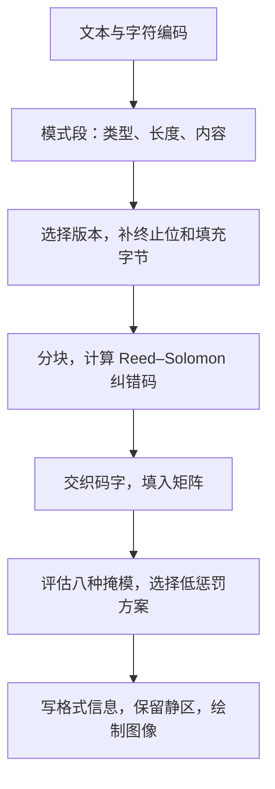

# QR Code：二维码原理与浏览器生成

## 二维码与数据

二维码是一类用二维图形承载数据的条码。常见的三个角带方形定位图案的二维码是 **QR Code**；本文讨论其中的 Model 2。Data Matrix、Aztec 等也属于二维条码，编码规则各不相同。

QR Code 把文本或字节编码为黑白方格。每个小方格称为**模块**（module），模块组成的矩阵同时包含定位图案、编码参数、数据和纠错信息。网址二维码通常只保存 URL 字符串，扫码软件识别后再决定是否打开网页。二维码本身不保存目标网页，也不保证网址可信。

## 在线生成器

输入文本或网址后点击生成，可以切换纠错等级，观察版本、矩阵尺寸和掩模编号，并下载 SVG。内容在浏览器内处理，生成过程不调用远程二维码接口；编码库随本站一起提供。

<iframe src="../assets/qr-code/generator.html" title="浏览器内二维码生成器" loading="lazy" style="width: 100%; height: 820px; border: 0; border-radius: 16px; display: block;"></iframe>

[单独打开生成器](assets/qr-code/generator.html)

可以依次尝试短网址、中文、较长文本，再切换纠错等级。同样的内容在不同纠错等级下，可能需要不同版本；内容相近也可能选中不同掩模。本页统一使用带 UTF-8 ECI 声明的字节模式，便于观察编码过程；专用数字模式可以让纯数字内容更紧凑。

## 矩阵结构

### 版本与模块

QR Code Model 2 有 40 个版本。版本决定矩阵边长，和软件版本无关。若版本为 $v$，每边模块数为：

$$
N = 17 + 4v,\qquad 1 \le v \le 40.
$$

版本 1 为 $21\times21$ 个模块，版本 2 为 $25\times25$，版本 40 为 $177\times177$。导出图片的像素数可以改变；在内容、版本和编码参数不变时，模块矩阵保持不变。

| 区域 | 作用 |
| --- | --- |
| 三个定位图案 | 位于左上、右上、左下，帮助发现二维码并确定方向 |
| 分隔区 | 定位图案周围的白色模块，分离图案与相邻内容 |
| 定时图案 | 黑白交替的横线和竖线，帮助确定模块网格 |
| 校正图案 | 版本 2 起出现，帮助处理透视、形变与采样位置 |
| 格式信息 | 保存纠错等级和掩模编号，有两份并带 BCH 纠错保护 |
| 版本信息 | 版本 7 起显式记录版本号，有两份并带 BCH 纠错保护 |
| 数据区域 | 承载数据码字、纠错码字；部分版本还有余数位 |
| 静区 | 矩阵外四周至少 4 个模块宽的空白，帮助分离背景 |

定位图案沿中心横切或竖切时，黑白宽度比例为 $1:1:3:1:1$。扫描器可以用这类结构从照片中寻找候选区域，再依据多个图案恢复网格位置。静区不计入 $N\times N$ 的矩阵尺寸。

### 容量与编码模式

容量取决于版本、纠错等级、编码模式以及分段开销，不能直接用模块总数换算字符数。功能图案占据部分位置，数据区域还需要容纳模式、长度和纠错信息。

| 模式 | 主要用途 | 数据压缩方式 |
| --- | --- | --- |
| 数字 | 数字字符 | 每 3 位数字用 10 比特，尾组另行处理 |
| 字母数字 | 数字、大写英文字母及部分符号，共 45 个字符 | 每 2 个字符用 11 比特，单个尾字符用 6 比特 |
| 字节 | 任意字节，包括 UTF-8 文本 | 每个字节用 8 比特 |
| 汉字（Kanji） | 规定范围的 Shift JIS 字符 | 每个字符用 13 比特；不等于任意中文模式 |

编码器可以把一段内容拆成多个模式段，以降低总比特数。ECI（Extended Channel Interpretation）用于声明后续字节的解释方式，不承载正文字符。

版本 40、L 级、单一相应模式下，最大容量可达 7089 位数字、4296 个字母数字字符或 2953 字节。2953 字节不等于 2953 个任意 Unicode 字符；本页额外加入 ECI 段，还会占用少量容量。

## 编码过程



### 文本转字节

文本需要先确定字符编码。例如 UTF-8 中，`A` 占 1 字节，`你好` 占 6 字节，`😀` 占 4 字节。JavaScript 字符串的 `length` 统计 UTF-16 码元数量，不能用作 UTF-8 字节长度。

本页先用 `TextEncoder` 得到 UTF-8 字节，再放置 ECI 赋值 26，明确声明后续字节按 UTF-8 解释。支持 ECI 的解码器可据此还原字符；较旧或未完整支持 ECI 的扫码软件可能存在兼容差异。

### 模式、长度与填充

一个普通数据段依次包含模式指示、字符计数和内容比特。字符计数字段的位宽取决于模式和版本范围；字节模式中的计数是字节数。ECI 段有自己的格式，不含普通数据段的字符计数字段。

以本页输入 `A`、选择 M 级为例，编码器可使用版本 1：

| 部分 | 比特串 | 含义 |
| --- | --- | --- |
| ECI 模式 | `0111` | 接下来是字符编码声明 |
| ECI 赋值 | `00011010` | UTF-8 的赋值 26 |
| 字节模式 | `0100` | 接下来是字节数据段 |
| 字节计数 | `00000001` | 版本 1 的字节计数字段宽 8 比特，此处为 1 字节 |
| 正文 | `01000001` | `A` 的 UTF-8 字节，即 `0x41` |

以上共 32 比特。编码器随后添加不超过 4 个零作为终止位，再补零对齐到字节边界；容量仍有剩余时，交替补入 `0xEC` 和 `0x11`。

版本 1 的 M 级共有 16 个数据码字和 10 个纠错码字，每个码字是 8 比特。本例在终止与对齐后占 5 个数据码字，继续填充到 16 个数据码字，再计算纠错信息。这些开销解释了为什么原文只有一个字符，二维码仍然有完整的模块矩阵。

### Reed–Solomon 纠错与交织

数据码字按标准规定分块。每个块在有限域 $\mathrm{GF}(256)$ 上计算 Reed–Solomon 纠错码字，再把各块的数据码字与纠错码字分别交织输出。交织将相邻输出码字分散到不同块，帮助缓解局部损坏集中打击同一个块的情况。

若某块有 $r$ 个纠错码字，存在 $t$ 个位置未知的错误码字和 $e$ 个位置已知的擦除码字，通常的可恢复条件为：

$$
2t+e\le r.
$$

同一码字内多个比特损坏仍计为一个错误码字；损坏分布到多个码字时，消耗的纠错能力会增加。版本 1、M 级只有一个块，10 个纠错码字最多可纠正其中 5 个位置未知的错误码字。

| 纠错等级 | 常见标称恢复能力 |
| --- | --- |
| L | 约 7% |
| M | 约 15% |
| Q | 约 25% |
| H | 约 30% |

这些比例描述码字层面的近似恢复能力。是否能读出还取决于损坏分布，以及定位、格式信息和采样是否成功，不能据此认定遮住任意同等面积都能恢复。提高纠错等级会占用更多容量，可能迫使版本增大；在固定图片尺寸下，模块也会变小。

### 矩阵填充与掩模

编码器先放置功能图案并保留相关区域，再把交织后的码字按高位在前写入矩阵。从右下角开始，沿两列宽的条带交替向上、向下移动，并跳过功能模块；定时图案所在列也需避开。

直接填入数据可能形成长串同色模块、大块同色区域，或类似定位图案的结构。QR Code 定义 8 种掩模，分别按坐标条件翻转数据区域的模块，包括数据、纠错与余数位；功能模块不参与这种翻转。

例如掩模 0 在 $x+y$ 为偶数的位置翻转模块。设原模块值为 $b(x,y)$、掩模条件为 $m(x,y)$，处理结果为：

$$
b'(x,y)=b(x,y)\oplus m(x,y).
$$

解码时用同一掩模再次异或，即可恢复原值。掩模用于改善图案的可读性，不提供保密性。

编码器逐一尝试 8 种方案，结合对应格式信息计算惩罚分数，主要惩罚长串同色、同色方块、类似定位图案的模式和黑白比例偏离，再选择低分方案。最终格式信息记录纠错等级和掩模编号，解码器由此知道如何去掩模。

## 扫码过程

扫码器从图像中定位三个角的图案，确定方向、估计透视变换，并利用定时图案和校正图案采样模块。之后读取格式信息和必要的版本信息，去除掩模，按规定顺序取出码字，逆交织并执行 Reed–Solomon 纠错，最后解析模式段和字符编码。

解码结果是数据。展示文本、打开 URL、连接 Wi-Fi 或解析联系人的行为，由扫码应用根据内容格式决定。常见“动态二维码”把固定的短网址写进二维码，再由服务器调整跳转目标，因此原图不变也能改变落地页；直接编码的文本不会自行更新。

## 页面实现

### 脚本引入与职责

生成器使用 Project Nayuki 的 [QR Code generator](https://www.nayuki.io/page/qr-code-generator-library)，支持 Model 2 的全部 40 个版本与 4 个纠错等级，采用 MIT 许可证。本站保存固定上游提交编译出的浏览器 JS，保留许可证；来源和复现命令见[依赖说明](assets/qr-code/README.md)。

笔记内嵌一个独立 HTML 页面，页面依次引入编码库和交互脚本：

```html
<script src="qrcodegen.js" defer></script>
<script src="generator.js" defer></script>
```

`defer` 让外部脚本在 HTML 解析完成后按顺序执行，交互脚本执行时可以访问表单和 `qrcodegen`。独立页面隔离生成器样式，也让笔记通过站点的即时导航进入时正常加载脚本。

| 文件 | 职责 |
| --- | --- |
| [generator.html](assets/qr-code/generator.html) | 表单、预览区和结果字段 |
| [generator.css](assets/qr-code/generator.css) | 布局、浅色与深色外观、焦点状态 |
| [generator.js](assets/qr-code/generator.js) | 输入处理、调用编码器、绘制及下载 SVG |
| [qrcodegen.js](assets/qr-code/qrcodegen.js) | 分段封装、版本选择、纠错、交织、矩阵与掩模算法 |

### UTF-8 分段与版本选择

下面是交互脚本的核心调用，`text` 表示输入字符串，`ecc` 表示选中的纠错等级：

```javascript
const { QrCode, QrSegment } = qrcodegen;
const bytes = new TextEncoder().encode(text);
const segments = [
  QrSegment.makeEci(26),
  QrSegment.makeBytes(Array.from(bytes)),
];
const qr = QrCode.encodeSegments(
  segments, ecc, 1, 40, -1, false,
);
```

`TextEncoder` 负责字符到 UTF-8 字节的转换。`makeBytes` 把这些字节变为一个字节模式段，`makeEci(26)` 声明其编码。这里保留首尾空白，也不根据输入是否像网址而修改内容。

`encodeSegments` 后四个参数分别规定最小版本、最大版本、掩模和是否自动提高纠错等级：

- `1, 40`：在全部版本中寻找能容纳这些段的最小版本。
- `-1`：自动评估 8 种掩模；指定 `0` 至 `7` 则固定使用对应掩模。
- `false`：严格使用用户选择的纠错等级。库默认允许在不增大版本时提高等级，此处关闭这一行为，便于比较 L、M、Q、H。

`qr.version`、`qr.size` 和 `qr.mask` 分别给出版本、每边模块数和掩模编号。`qr.getModule(x, y)` 返回指定坐标是否为黑色模块。

### 编码库内部的实现

`encodeSegments` 先用 `QrSegment.getTotalBits` 计算每个候选版本所需比特数，再与 `getNumDataCodewords` 给出的数据容量比较。选定版本后，它拼接模式、长度、内容和填充字节，交给 `QrCode` 构造器。

构造器中的主要调用顺序是：

```javascript
this.drawFunctionPatterns();
const allCodewords = this.addEccAndInterleave(dataCodewords);
this.drawCodewords(allCodewords);
```

`drawFunctionPatterns` 绘制功能图案，并用 `isFunction` 标记这些位置。`addEccAndInterleave` 根据版本和纠错等级查表分块，通过 `reedSolomonComputeDivisor`、`reedSolomonComputeRemainder` 计算各块纠错码字，再交织。`drawCodewords` 按两列一组的折返顺序放入比特，跳过已标记的位置。

自动选掩模时，库对每个候选方案执行 `applyMask`、`drawFormatBits` 和 `getPenaltyScore`，记录分数后再次调用同一 `applyMask` 撤销翻转。遍历结束后应用最终方案，并重新写入格式信息。这个过程利用了异或两次恢复原值的性质，避免为每种掩模复制整张矩阵。

### 矩阵绘制与下载

SVG 只负责表现编码器已经算好的矩阵。`createQrSvg` 把每个黑色模块画成一个单位方块，核心循环如下：

```javascript
const border = 4;
const side = qr.size + border * 2;
const cells = [];
for (let y = 0; y < qr.size; y++) {
  for (let x = 0; x < qr.size; x++) {
    if (qr.getModule(x, y)) {
      cells.push(`M${x + border},${y + border}h1v1h-1z`);
    }
  }
}
path.setAttribute("d", cells.join(""));
```

`border` 让每个模块向右、向下偏移 4 个单位；`viewBox` 设为从原点开始、边长 `side` 的正方形，就在四周留下 4 个模块宽的静区。路径命令表示移动到模块左上角，再沿四边闭合。所有黑色模块合成一条路径，可减少 SVG 节点数量。

完整函数用 `document.createElementNS` 创建 SVG 元素，添加纯白背景、纯黑路径和 `shape-rendering="crispEdges"`。背景保持不透明，深色主题下也保留正确的黑白关系。打印或转成位图时，应保留静区，尽量按整数倍模块尺寸渲染，避免模糊缩放；高版本在小屏预览中模块较密，可下载 SVG 放大查看。

下载时，脚本用 `XMLSerializer` 序列化 SVG，创建 `Blob` 和临时对象 URL，再触发带 `download` 属性的链接。下载触发后延迟调用 `URL.revokeObjectURL` 释放资源，整个过程无需服务器生成文件。

### 输入状态与错误处理

输入内容或纠错等级改变后，脚本立即移除旧图、隐藏旧参数并禁用下载，提示重新生成。这样预览与下载始终对应已经确认的输入。空文本会提示补充内容；超出容量时捕获编码库的 `RangeError`，提示缩短文本或降低纠错等级。

输入只交给 `TextEncoder`，不拼接进 HTML。SVG 路径只包含编码器产生的模块坐标，状态文字使用 `textContent` 写入，因此输入类似 HTML 的文本时，生成器仍将其作为普通数据编码。

## 参考资料

- [DENSO WAVE：版本与容量](https://www.qrcode.com/en/about/version.html)
- [DENSO WAVE：纠错能力](https://www.qrcode.com/en/about/error_correction.html)
- [DENSO WAVE：静区与打印尺寸](https://www.qrcode.com/en/howto/code.html)
- [Project Nayuki：QR Code generator library](https://www.nayuki.io/page/qr-code-generator-library)
- [Project Nayuki：逐步生成二维码](https://www.nayuki.io/page/creating-a-qr-code-step-by-step)
- [Project Nayuki：本文所用上游源码](https://github.com/nayuki/QR-Code-generator/blob/3c6d0b3cefb4e049dc337e82237c9644399716a8/typescript-javascript/qrcodegen.ts)
