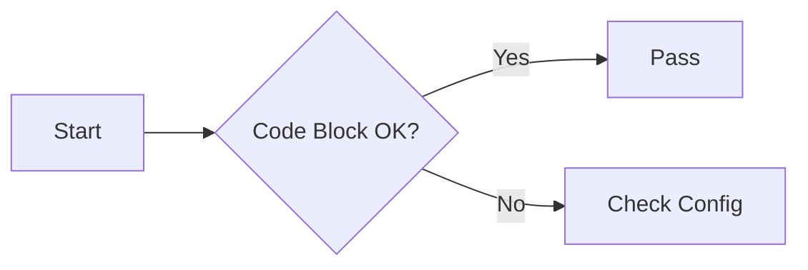

# 功能检查

## Callout

普通 callout 使用 `!!! type "标题"` 语法。callout 正文需要缩进 4 个空格。

### note

!!! note "定义"
    适合放定义、说明或背景信息。

### danger

!!! danger "危险"
    适合放高风险操作或严重后果提示。

### tip

!!! tip "技巧"
    适合放解题技巧、使用建议或捷径。

### warning

!!! warning "警告"
    适合放明显的注意事项和易错点。

### info

!!! info "信息"
    这是一个 info callout。

### success

!!! success "成功"
    这是一个 success callout。

### example

!!! example "示例"
    这是一个 example callout。

### question

!!! question "问题"
    这是一个 question callout。

### abstract

!!! abstract "摘要"
    这是一个 abstract callout。

### bug

!!! bug "Bug"
    这是一个 bug callout。

### quote

!!! quote "引用"
    这是一个 quote callout。

### failure

!!! failure "失败"
    这是一个 failure callout。

### 折叠式 Callout

折叠式 callout 使用 `??? type "标题"` 和 `???+ type "标题"` 语法。

`???` 表示默认折叠，`???+` 表示默认展开。

??? note "默认折叠"
    这是一个默认折叠的 callout。当前仓库约定不要使用 `???-` 写法。

???+ warning "默认展开"
    这是一个默认展开的 callout。

### 留白解答区

题目下方的空白区域可点击展开参考解答，也可用 Tab 聚焦后按 Enter 或空格；再次点击可收起。打印时自动显示解答。

!!! question "示例：点击空白区显示解答"
    计算 $3 \times 4$。

    <details class="exercise-answer notebook-interactive-fallback" id="exercise-answer-demo" markdown="block">
    <summary aria-label="显示示例题参考解答" data-print-fallback="exercise-answer-demo"><span class="exercise-answer-hint">点击显示参考解答</span></summary>
    <div class="exercise-answer-content" markdown="1">

    **参考解答：**$3 \times 4=12$。

    </div>
    </details>

## 概念辨析卡 { #concept-cards }

分别判断两句话，作答后查看解释；完成两句后显示关系提示与情境题。支持切换卡片、重做本卡和键盘操作，回答只保留在当前页面。

<div class="concept-cards" data-concept-src="../../assets/concept-cards/demo.json" data-print-fallback="concept-cards-demo-static" aria-label="概念辨析卡示例">
<p class="concept-cards__fallback">互动卡片暂不可用时，可阅读下方的静态辨析。</p>
</div>

<details class="notebook-interactive-fallback" id="concept-cards-demo-static" markdown="block">
<summary>静态辨析与打印内容</summary>

| 表述 | 判断与理由 |
| --- | --- |
| 正方形一定是四个角都是直角的四边形 | 成立，这是正方形的必要性质 |
| 四个角都是直角的四边形一定是正方形 | 不成立，还需要四边相等 |

情境题：一张卡片有四个直角，长与宽不同，因此它是正方形。该判断不成立，因为四边不相等。

</details>

复用时配置独立的 JSON 数据，在正文放置容器，并提供静态内容供加载失败时阅读与打印。数据地址相对于页面 URL 解析。

```html
<div class="concept-cards" data-concept-src="../assets/example.json" aria-label="概念辨析">
  <p class="concept-cards__fallback">互动卡片暂不可用时，可阅读静态辨析。</p>
</div>
```

数据使用以下结构；每张卡包含两句话与一道情境题，关键词使用 `highlight` 标记。

```json
{
  "title": "概念辨析",
  "cards": [{
    "id": "example",
    "title": "判断方向",
    "statements": [
      {"segments": ["原句", {"highlight": "关键词"}], "correct": true, "explanation": "理由"},
      {"segments": ["变式", {"highlight": "关键词"}], "correct": false, "explanation": "理由"}
    ],
    "principle": "两句话的关系",
    "transfer": {"prompt": "情境判断", "correct": false, "explanation": "理由"}
  }]
}
```

## 概念树 { #concept-tree }

展开分支查看概念层次，点击名称查看说明。树枝表示内容归属或包含关系，交叉联系单独列在说明中。

<div class="concept-tree" data-concept-src="../../assets/concept-tree/demo.json" data-concept-focus="rectangle" data-print-fallback="concept-tree-demo-static" aria-label="几何概念树示例">
<p class="concept-tree__fallback">交互未加载时，可展开下方的文字层次。</p>
</div>

<details class="notebook-interactive-fallback" id="concept-tree-demo-static" markdown="block">
<summary>文字层次与打印内容</summary>

- 四边形
    - 平行四边形
        - 长方形
            - 正方形
        - 菱形

此树省略其他四边形。正方形同时满足长方形与菱形的定义，这一交叉联系在节点说明中单独呈现。

</details>

复用时更换数据地址和定位节点，并提供文字层次供加载失败时阅读及打印。数据地址相对于页面 URL，数据内的笔记链接相对于 JSON 文件；两者均限于本站。

```html
<div class="concept-tree" data-concept-src="../assets/concepts.json"
     data-concept-focus="example" data-print-fallback="example-static"
     aria-label="概念树">
  <p class="concept-tree__fallback">可阅读下方的文字层次。</p>
</div>
```

数据由 `title` 和 `root` 组成；节点使用唯一的 `id`，`children` 表示下级分支，`href` 可链接已有笔记，`relations` 指向树内的其他节点。`noteType` 可设为 `outline`（框架）、`index`（目录）或 `explanation`（精讲，默认），入口显示对应的内容类型。

```json
{
  "title": "概念树",
  "root": {
    "id": "system", "label": "理论体系", "summary": "体系说明",
    "children": [
      {"id": "example", "label": "当前概念", "summary": "概念说明",
       "href": "../example/",
       "relations": [{"target": "related", "text": "两者的联系"}]},
      {"id": "related", "label": "相关概念", "summary": "相关说明"}
    ]
  }
}
```

### 总览与笔记定位

总览模式提供搜索和带有笔记入口的概念树，URL 参数 `?concept=节点ID` 可直接定位；`data-concept-expanded` 可指定初始展开的节点 ID，以空格分隔。笔记模式使用 `data-concept-focus` 标记本文，并通过 `data-concept-overview` 返回总览中的同一节点；总览地址相对于页面 URL。

“完整概念树”和笔记链接均在新标签页打开，保留当前页面的阅读位置。文字版入口使用相同方式，例如：[马原总体概念树 ↗](general/zz/marxism-concept-tree.md){ target="_blank" rel="noopener noreferrer" title="新标签页打开" }。

<div class="concept-tree" data-concept-mode="overview" data-concept-src="../../assets/concept-tree/demo.json" data-print-fallback="concept-tree-overview-demo-static" aria-label="概念树总览示例">
<p class="concept-tree__fallback">交互未加载时，可展开下方的文字层次。</p>
</div>

<details class="notebook-interactive-fallback" id="concept-tree-overview-demo-static" markdown="block">
<summary>总览示例的文字层次与打印内容</summary>

四边形 → 平行四边形 → 长方形 → 正方形；平行四边形也包含菱形，正方形同时具有菱形的性质。

</details>

```html
<!-- 独立总览 -->
<div class="concept-tree" data-concept-mode="overview"
     data-concept-src="../assets/concepts.json" aria-label="总体概念树"></div>

<!-- 单篇笔记开头的定位 -->
<div class="concept-tree" data-concept-title="体系位置"
     data-concept-src="../assets/concepts.json" data-concept-focus="example"
     data-concept-overview="../concept-tree/" aria-label="本文在体系中的位置"></div>
```

两种模式共用同一份数据。新增笔记时，在对应节点补充 `href`，并在笔记入口填写相同的节点 ID。实际使用时均需提供 `data-print-fallback` 对应的文字内容。

## Markdown List

### 有序列表续段

有序列表项内可以在空行后继续写段落，续段缩进到列表项正文列。

1. **第一项**

   这是第一项的第二段，应该仍然渲染在同一个列表项内。

2. **第二项**

   这是第二项的第二段，列表编号应该继续为 `2`。

## Code Block

### 基础代码块

```python
def hello(name: str) -> str:
    return f"Hello, {name}"
```

### 标题与高亮行

```python hl_lines="2 3" title="highlight-demo.py"
def add(a: int, b: int) -> int:
    result = a + b
    return result
```

### 行号

```python linenums="1" title="linenums-demo.py"
for i in range(3):
    print(i)
```

### 代码注释

```python title="annotation-demo.py"
def square(x: int) -> int:
    return x * x  # (1)!
```

1.  这里测试代码注释是否正常显示。

### 内容标签页

=== "Python"

    ```python
    print("Hello from Python")
    ```

=== "JavaScript"

    ```javascript
    console.log("Hello from JavaScript");
    ```

### Mermaid




## Math

行内公式：$E = mc^2$

块级公式：

$$
\int_0^1 x^2 \, dx = \frac{1}{3}
$$
